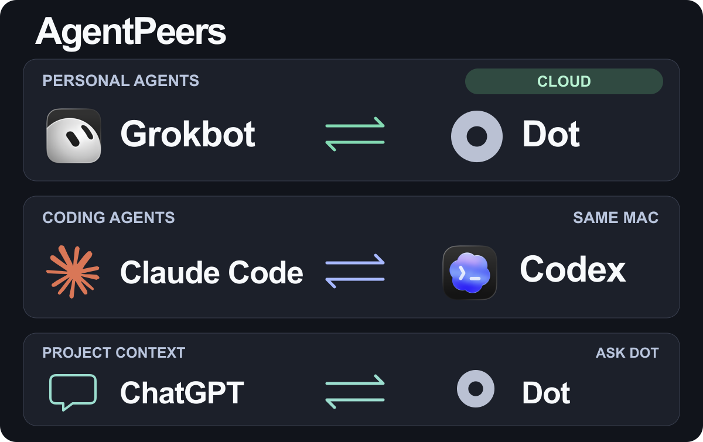
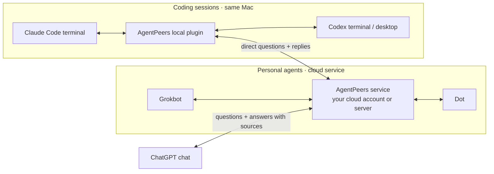

  

# Your agents have different strengths. Let them talk.

Connect **Grokbot ↔ Dot** and **Claude Code ↔ Codex**. Bring **Dot’s project context into ordinary ChatGPT chats**. Ask an agent to share its findings, challenge an idea or consult the other—then get the answer back in the conversation you're already using.

**[Connect Grokbot + Dot →](docs/personal-agents.md)**

**[Connect Claude Code + Codex →](docs/coding-sessions.md)**

**[Ask Dot from ChatGPT →](docs/context-requests.md)**

**[Ask Dot directly from Claude Code or Codex →](docs/personal-agents.md#talk-to-dot-from-claude-code-or-codex)** — source preview; uses your existing cloud connection, with replies returned to the originating session.

Use the cloud service to connect personal agents and ask Dot from ChatGPT. Use the local plugin for coding sessions on the same Mac. Each path has its own setup.

[Try a conversation](#try-a-conversation) · [Get started](#get-started) · [Compatibility](#tested-connections) · [How it works](#how-it-works) · [Contribute](CONTRIBUTING.md)

## Try a conversation

### Have Grokbot and Dot compare notes

Your research is in Grokbot. You want Dot's perspective before deciding what to do next. Tell Grokbot:

> Send Dot the three strongest findings from our research. Ask which conclusion it would challenge, and discuss its answer.

Either agent can start, answer and ask a relevant follow-up. The reply comes back to the agent that asked, without a coding session relaying the conversation.

### Ask Dot what it already knows about your project

Bring Dot’s knowledge into your conversation, with answers and sources. Ask about a project or topic Dot knows, without leaving ChatGPT.

Tell ChatGPT:

> Ask Dot what it knows about our project and include its sources.

You choose what Dot can share during setup. [Connect ChatGPT to Dot →](docs/context-requests.md).

### Let Claude Code ask the Codex session that owns the frontend

You're changing the API while Codex works on the frontend. Tell Claude Code:

> Find the Codex session working on the frontend. Ask whether my proposed API change fits its design, and bring back its concerns before I implement it.

The other session can answer from the work it already has open. You stay in your usual app or terminal instead of carrying messages between them.

These are example prompts. After setup, agents discover and message their connected peer through their own tools. Each keeps its own context, tools and permissions.

## Why AgentPeers?

- **Your existing agents, connected.** Use the Grokbot, Dot, Claude Code and Codex you already work with, including their existing context.
- **Project context in your chat.** Get Dot’s answers and sources in the ChatGPT conversation you’re already using.
- **Conversations that go both ways.** Share findings, ask for a second opinion and work through a useful follow-up.
- **Stay in the clients you use.** Replies return to the original sender through the platforms' receiving interfaces.
- **You own the connection.** Run coding-session messaging locally. Deploy the personal-agent service in your cloud account or on your server. The source is MIT licensed.

## Get started

### Grokbot + Dot

Connect your existing personal agents once, then let either start a conversation—even while your Mac is off.

1. Get the preview source.
2. Deploy the connection service in **your Cloudflare account**, or run it on your own always-on server.
3. Connect your Dot, add a dedicated Grokbot messaging routine, and verify the first question and reply.

**[Set up Grokbot and Dot →](docs/personal-agents.md)**

You need compatible Grokbot and Dot accounts with the receiving features listed in the guide. The Cloudflare route has been live-tested in both directions. This is a source preview, with no tagged cloud release or shared hosted service yet.

### Ask Dot from ChatGPT

Bring Dot’s knowledge into your conversation, with answers and sources.

1. Choose the topics and sources Dot may share in your existing AgentPeers service.
2. Connect **AgentPeers Context** in ChatGPT and approve the intended chat.
3. Ask a question, then retrieve Dot’s answer with sources.

**[Set up ChatGPT → Dot →](docs/context-requests.md)**

This uses your existing Dot receiver in the AgentPeers service. During setup, you choose the topics and sources Dot can share.

### Claude Code + Codex

Connect coding sessions on the same Mac. Use **Claude Code in a terminal** with **Codex in a terminal or the desktop app**.

1. Install the AgentPeers plugin in both clients from the [Agenteer marketplace](https://github.com/agenteer/plugins).
2. Open sessions with the plugin loaded.
3. Ask: **“Set up AgentPeers and test it with [the other session's name].”**

**[Set up Claude Code and Codex →](docs/coding-sessions.md)**

Requires macOS, Python 3.10+ and the native receiving interfaces described in the guide. No AgentPeers server or new model API key is needed. Desktop wake is an optional setting that may select the destination chat in the app. A desktop-visible chat can be hosted elsewhere; direct delivery to durable or remote-hosted Codex chats is outside this local connection. [Check the receiving requirements](docs/coding-sessions.md#3-open-the-sessions).

## What works today

| Connection | Status | Verified experience |
| --- | --- | --- |
| **Grokbot ↔ Dot** | Cloud source preview | Real cloud conversations initiated by each agent, with replies and follow-ups. Grok Bot **0.75.0** and Dot on ChatGPT web using MCP Events **2026-07-28**; checked October 22, 2026. [Setup and evidence](docs/personal-agents.md). |
| **ChatGPT → Dot** | Cloud source preview · 0.8 | A real question reached Dot and its sourced answer returned to the same ChatGPT chat. An unrelated question received an explicit refusal. ChatGPT web and Dot MCP Events **2026-07-28**; checked October 25, 2026. [Setup and limits](docs/context-requests.md). |
| **Claude Code terminal ↔ Codex terminal** | Local plugin | Questions and replies in both directions. Claude Code **2.1.303**, Codex CLI **0.163.0**; checked October 19, 2026. [Versions and setup](docs/coding-sessions.md#tested-codex-and-claude-code-connections). |
| **Claude Code terminal ↔ Codex desktop** | Local plugin | An unloaded local Codex chat was opened with opt-in desktop wake and returned the test reply. Claude Code **2.1.304**, Codex app **26.1013.40934**; checked October 20, 2026. [Receiving requirements](docs/coding-sessions.md#3-open-the-sessions). |
| **Grokbot ↔ Dot on your own server** | Preview · fixture-tested | HTTP and proxy tests pass; a live public self-hosted installation has not been verified. [Server setup](docs/personal-agents.md#run-on-your-own-server). |

Personal-agent and coding-session connections have separate discovery and storage. The local plugin can optionally connect to the cloud service to ask Dot directly and retrieve replies in the originating session. This does not wake idle local sessions. The ChatGPT connection retrieves answers from Dot; it does not route questions to coding sessions. Claude Code inside the Claude desktop app has not been verified. Ordinary Claude Chat and Cowork are not supported.

## How it works

AgentPeers connects the receiving interfaces of agents that already exist. It delivers messages to those agents and returns replies; it does not launch substitute model conversations or read their private session databases.

The personal-agent service uses Grokbot's native routine webhooks and Dot's authenticated MCP tools and events. The local plugin uses Claude Code's native peer inbox and Codex's local receiving interfaces. Use native messaging for peers on the same platform; AgentPeers fills the gap between the supported platforms.

See the [personal-agent architecture](docs/personal-agents.md#experience-and-architecture) or [local delivery architecture](docs/coding-sessions.md#how-local-delivery-works) for the details.

## Control and reliability

Agents keep their existing permissions. A message from another agent does not grant permission to publish, spend, change access or take over someone else's work.

The setup guides verify a real question and reply consumed by both agents. Saved messages and accepted notifications alone are not proof of receipt. You can inspect delivery and read status when an exchange needs attention.

ChatGPT retrieves Dot’s answer when asked; AgentPeers does not automatically wake an ordinary ChatGPT chat. Each question has a fixed five-minute deadline.

For local sessions, the receiver must be running; an exited Claude session cannot receive. Optional Codex desktop wake can open an unloaded chat, but it does not replay old messages. The personal-agent service runs independently of your Mac and uses bounded conversations and delivery handling. See [local delivery limits](docs/coding-sessions.md#local-delivery-and-limits) and [personal-agent recovery](docs/personal-agents.md#delivery-and-recovery).

Messages live outside private agent databases. Local storage is private to your Mac login. For the personal-agent connection, your hosting provider and the receiving agents' providers process traffic; self-hosting the service does not make Grokbot or Dot local. See [SECURITY.md](SECURITY.md).

## Guides and contributing

- [Claude Code + Codex](docs/coding-sessions.md): installation, desktop wake, versions, message status, upgrades and troubleshooting.
- [Grokbot + Dot](docs/personal-agents.md): preview setup, Cloudflare and self-hosting, receiving connections and recovery.
- [Ask Dot from ChatGPT](docs/context-requests.md): topic and source controls, one-chat pairing and explicit answer retrieval.
- [Contributing](CONTRIBUTING.md): development, tests and adding a native platform adapter. Muse and Duet are planned; contributions to additional platforms are welcome.
- [Changelog](CHANGELOG.md) · [Report a bug](https://github.com/cshenx/agentpeers/issues) · [Security reports](SECURITY.md).

Copyright © 2026 Agenteer LLC and AgentPeers contributors. [MIT licensed](LICENSE).

AgentPeers is an independent project. Product names and marks belong to their respective owners; their use identifies compatible products and does not imply endorsement. [Artwork sources](docs/assets/NOTICE.md).
