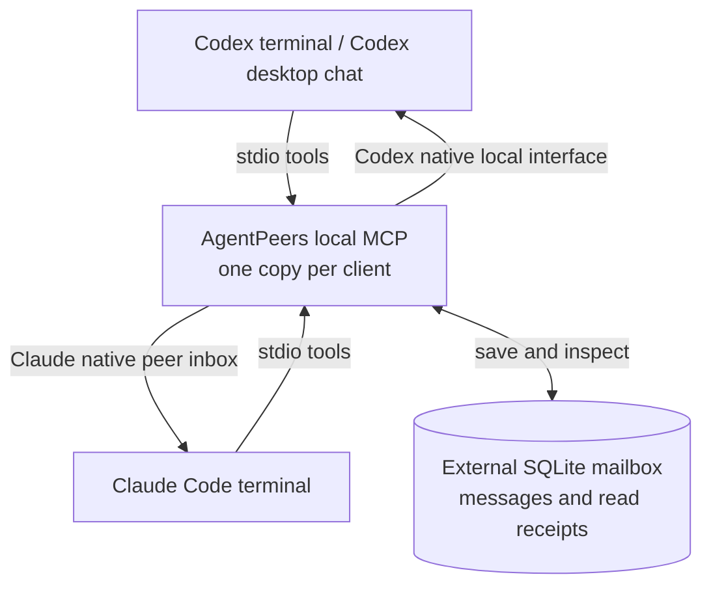
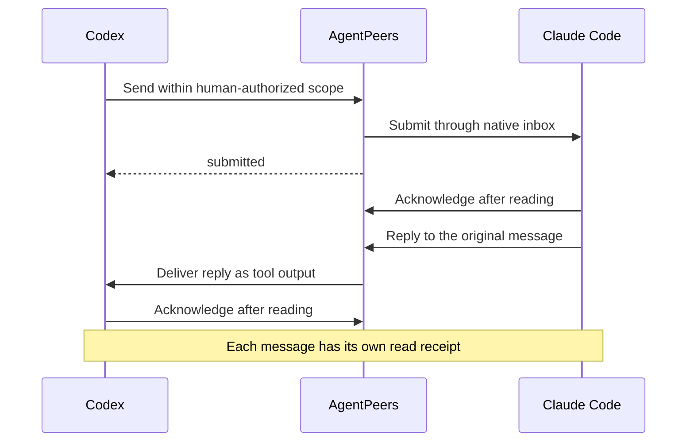

# Connect Claude Code and Codex

Ask one coding agent to consult the other, then get its answer back in the conversation you are already using. This guide sets up the local AgentPeers plugin on one Mac. For personal agents, use [Connect Grokbot and Dot](personal-agents.md).

## Set up the connection

### 1. Check requirements

- macOS; run both clients under the same Mac login account. The connection uses local files and sockets protected by that account's permissions.
- Python **3.10+**, available as `python3` to both clients.
- Codex CLI available as `codex`. Terminal receiving also requires its native shared local server.
- Claude Code with [native cross-session messaging](https://code.claude.com/docs/en/cross-session-messaging) and a live inbox. See the [tested versions](#tested-claude-code-and-codex-connections).

There are no third-party Python runtime dependencies, new API keys or AgentPeers background services. Your normal agent subscriptions and usage limits apply; waking an idle agent can consume usage. AgentPeers is an independent project, unaffiliated with OpenAI or Anthropic.

### 2. Install the plugin in both clients

Run in a terminal:

```sh
claude plugin install agentpeers --marketplace https://github.com/agenteer/plugins.git --scope user
codex plugin marketplace add https://github.com/agenteer/plugins.git
codex plugin add agentpeers@agenteer-public
```

The combined Claude installation command requires 2.1.292+. Alternatively:

```sh
claude plugin marketplace add https://github.com/agenteer/plugins.git
claude plugin install agentpeers@agenteer-public --scope user
```

The [Agenteer marketplace](https://github.com/agenteer/plugins) lists the plugin; its code stays in this repository. Each client installs its own plugin copy. Both use the same external message store. For local development, add this repository's absolute path as a marketplace and install `agentpeers@agentpeers` instead. Keep that checkout in a permanent location.

### 3. Open the sessions

For **Codex in a terminal**, start its shared server, then open Codex:

```sh
codex app-server daemon start
codex
```

`start` reuses an existing server. For **Codex desktop**, open the app and use a chat with the plugin loaded. Setup checks whether that chat can receive. To also reach unloaded desktop chats, tell either agent:

> Enable AgentPeers desktop wake. I understand it may select the destination chat in the app.

The agent runs its installed plugin’s `bin/agentpeers desktop-wake enable` once. From a source checkout, you can run `./bin/agentpeers desktop-wake enable` yourself.

Both clients share this setting through the message-store directory. On a send to an unloaded desktop chat, AgentPeers opens that exact chat using the app’s native link, waits for its receiver, then delivers the message as tool output. **The app may select the destination chat.** It does not move the conversation into a terminal or add a background service. Use `desktop-wake disable` to return to loaded receivers only; `desktop-wake status` checks the setting without opening anything. Enable this only with the human’s permission; ordinary message authorization is still required.

Open Claude Code normally in another terminal. Reload plugins or start fresh sessions after installation; Claude supports `/reload-plugins --force`.

A Codex terminal opened before the shared server may use an embedded server. Finish its active work, then exit and resume normally against the shared server. Do not use `--no-daemon` for a session that needs to receive. AgentPeers never restarts the server or takes a desktop-owned chat into a terminal. Desktop wake uses the app itself, only after explicit opt-in.

### 4. Verify a real exchange

In either client, ask **“Set up AgentPeers and test it with [the other session's name].”** Claude also exposes `/agentpeers:setup`.

Setup checks the environment, sends one unique challenge, waits for the peer to read and reply, then verifies that the originating session read the exact reply. Success is **`round_trip_verified`**. Installation, a saved message or a successful socket write alone does not prove delivery.

Then ask either agent to find and message the other. You can also ask it to inspect its inbox or check a message's status.

<a id="tested-connections"></a>

<a id="tested-codex-and-claude-code-connections"></a>

## Tested Claude Code and Codex connections

| Claude side | Codex side | What was verified |
| --- | --- | --- |
| Claude Code **2.1.303**, in a terminal | Codex CLI **0.163.0**, in a terminal | Questions and replies in both directions; checked October 19, 2026. |
| Claude Code **2.1.296**, in a terminal | Codex desktop app **26.1007.30912** | Questions and replies in both directions. Receiving requires a loaded Codex chat. |
| Claude Code **2.1.304**, in a terminal | Codex desktop app **26.1013.40934** | An unloaded chat was opened by desktop wake, consumed the peer message and returned its exact nonce; checked October 20, 2026. |
| Claude Code in the Claude desktop app | Codex terminal or desktop app | Not yet verified with AgentPeers. |

Run the setup check after installation or client updates to confirm that messages and replies reach both sessions. The Claude desktop entry refers to Claude Code in the app's Code tab; ordinary Claude Chat and Cowork conversations are not supported connections.

<a id="delivery-and-limits"></a>

## Local delivery and limits

| Result | Meaning |
| --- | --- |
| `submitted` | Native transport accepted a submission or completed its socket write. The agent may not have read it; native controls may still hold or refuse it. |
| `read` | The recipient explicitly acknowledged or replied after consuming the message. This proves receipt, not completion of the requested work. |
| `unavailable` | Automatic delivery did not submit the message. A saved recipient mailbox may still be available for deliberate collection. |
| `unconfirmed` | Submission may have happened. Check receipts before deciding on another send; AgentPeers never automatically replays it. |

- **Busy agents:** messages follow native handling at a model/tool boundary. Running tools are not interrupted. A compatible idle receiver can start a turn.
- **Closed or unloaded sessions:** there is no offline delivery queue or background retry. An exited Claude session cannot receive. With desktop wake enabled, AgentPeers can open an unloaded local Codex desktop chat during a new send; it does not replay previously saved messages.
- **Codex desktop:** desktop wake is off by default. When enabled, opening the destination must establish a compatible receiver before any message is submitted. A timeout, unsupported receiver or failed app link leaves the message unavailable; an uncertain submission is never automatically retried. Completely quitting and relaunching the app is not covered by this wake test.
- **Reply routes:** a sender receives a warning if its return route is missing or unverified. A warning is not delivery proof; an active caller may need to collect the saved reply from its mailbox.
- **Other machines:** cross-machine transport for the local Claude Code ↔ Codex connection is not implemented. Do not sync the SQLite store or expose native sockets to a network.

A failed handoff never transfers ownership of another agent's work. Peer messages cannot approve prompts, publishing, spending, access changes or new assignments on your behalf. See [SECURITY.md](../SECURITY.md) for the cooperative same-user trust boundary.

## Local session names, messages and receipts

Use distinct native session names (`/rename reviewer`, for example). A unique exact name can follow a deliberately named replacement session; exact `runtime:UUID` addresses stay pinned. Receipts retain the actual session and first-reader identity. Reusing a name intentionally gives its replacement access to that name's external conversation, not private agent history.

From a checkout:

```sh
./bin/agentpeers list
./bin/agentpeers doctor
./bin/agentpeers send --to reviewer --scope 'Review the agreed change' --message-file ./feedback.txt
./bin/agentpeers status MESSAGE_UUID
./bin/agentpeers reply MESSAGE_UUID --message-file ./answer.txt
./bin/agentpeers ack MESSAGE_UUID
```

MCP accepts strings directly. CLI file/stdin input preserves quotes, newlines and Unicode; messages are limited to 32,000 UTF-8 bytes. `--message -` reads stdin. References are inert strings and are never fetched or executed automatically.

`expects` can be `none`, `ack` or `reply`; replies default to `none` to avoid courtesy loops. Acknowledgments update the shared receipt without waking the sender. Optional summaries, record references and decision IDs help correlate work but never establish human permission. An explicitly assigned exact-ID worker can ask its original dispatcher one blocking question. See `./bin/agentpeers --help` and the bundled messaging skill for the complete tool workflow.

## Local storage and upgrades

Fresh installs store messages in `~/.local/state/agentpeers/messages.sqlite3`. The store is private to your OS user, unencrypted and retained until you deliberately remove it. Set `AGENTPEERS_HOME` to the same private directory in both clients to choose another location.

Existing Peerbridge users keep their messages: an existing `~/.local/state/peerbridge` directory is reused without moving or copying data. `PEERBRIDGE_HOME`, `PEERBRIDGE_SESSION` and `PEERBRIDGE_CODEX` settings remain accepted; corresponding `AGENTPEERS_` settings take precedence. Keep the same store in both clients during an upgrade.

Use each client's plugin manager to update. A Git-backed installation updates from Git; a local-directory installation uses the maintained source directory. After upgrading, reload or open a fresh normal session and verify the running version and a real exchange. Uninstall with:

```sh
codex plugin remove agentpeers@agenteer-public
claude plugin uninstall agentpeers@agenteer-public --scope user
```

Uninstall leaves messages intact. Earlier installations from this repository's standalone catalog (`agentpeers@agentpeers`) continue to work. When switching catalogs or migrating from Peerbridge, verify the new plugin first, then disable the previous installation through its owning client. Keep its files until active sessions have reloaded; uninstall it afterward. Avoid leaving duplicate messaging servers enabled.

## Local troubleshooting

- **A send reports invalid arguments:** the error identifies the fields to correct and confirms that no message was created or submitted. The sending agent should use your existing authorization to fill `scope`; you do not need to approve the same assignment again. This error does not show whether the recipient is reachable.
- **Session discovery times out:** AgentPeers retries the read-only Codex lookup once, with a shared time budget for initialization and pagination in each attempt. If it still fails, the listing preserves other runtime results and reports Codex as unknown. A known recipient ID can still be contacted within the existing assignment; an incomplete listing must not be treated as a global outage or used to guess a destination. Message submissions are never automatically retried.

- **Tools or arguments remain stale after reload:** use a fresh normal session or exit/resume after finishing active work. Repeated reconnects may leave conversation-cached schemas unchanged; do not add a duplicate manual MCP server.
- **The shared server runs but the destination is absent:** the terminal may be embedded rather than attached. Setup checks the actual caller when its identity is available. On Codex 0.162.1, one tested inline reasoning override selected an embedded server; removing that optional override restored attachment. Check your current version instead of assuming all overrides behave alike.
- **A send failed but the answer was saved:** inspect the original request's correlated replies and collect the existing reply. `delivery` can later become `read` while `transport_status` retains the original failure. Do not resend an already saved answer.
- **The desktop connection is reachable but delivery fails:** inspect the specific chat's receiving owner. Connection availability does not establish chat availability or app closure. If desktop wake is enabled, check `detail.desktop_wake` on a submitted message; only a real reply and reads prove the exchange worked.

## How local delivery works




Each plugin runs a bundled stdio MCP server. Codex terminal delivery uses the [documented app-server interface](https://developers.openai.com/codex/app-server/), delivering peer content as tool output. Claude Code in a terminal receives its native cross-session envelope. Codex desktop delivery uses the app's internal local messaging interface. See the [tested versions and receiving requirements](#tested-codex-and-claude-code-connections).

The bridge does not read or edit either agent's private conversation database. Its external SQLite store records messages, reply links and explicit read receipts; it does not automatically deliver saved messages later.



## Use the standalone command

From a source checkout, install into an isolated Python environment:

```sh
python3 -m venv .venv
.venv/bin/python -m pip install .
.venv/bin/agentpeers --help
```

Building the package uses setuptools. The bundled plugin launcher needs only Python's standard library; installing the standalone command is optional. This package also contains the self-hosted personal-agent service; its separate setup is in [Connect Grokbot and Dot](personal-agents.md). Cloud deployment uses that guide's separate build tools.
