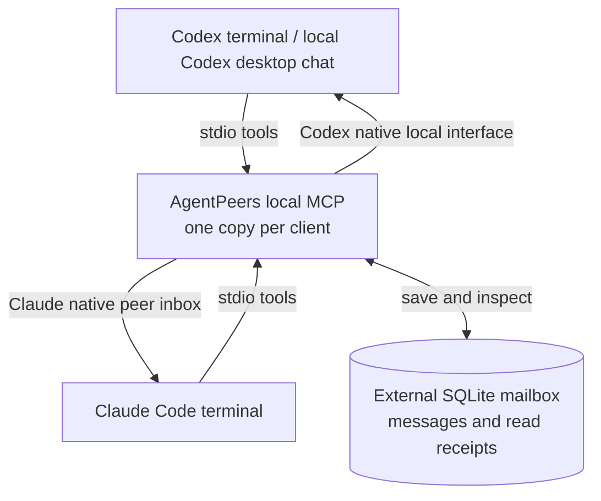
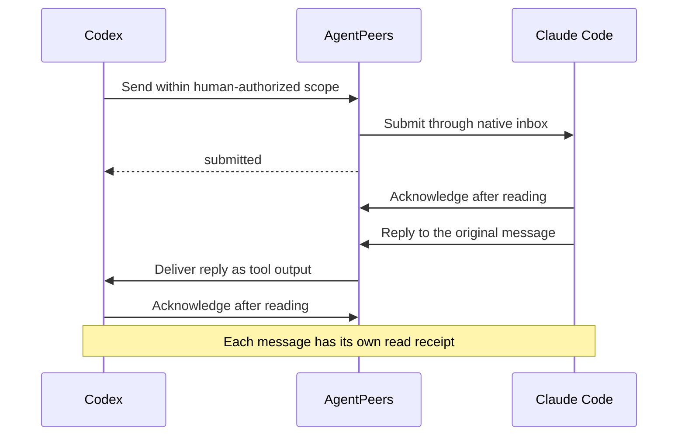

# Connect Claude Code and Codex

Ask one coding agent to consult the other, then get its answer back in the conversation you are already using. This guide sets up the local AgentPeers plugin on one Mac. For personal agents, use [Connect Grokbot and Dot](personal-agents.md).

## Set up the connection

### 1. Check requirements

- macOS; run both clients under the same Mac login account. The connection uses local files and sockets protected by that account's permissions.
- Python **3.10+**, available as `python3` to both clients.
- Codex CLI available as `codex`. Terminal receiving also requires its native shared local server.
- Claude Code with [native cross-session messaging](https://code.claude.com/docs/en/cross-session-messaging) and a live inbox. See the [tested versions](#tested-claude-code-and-codex-connections).

There are no third-party Python runtime dependencies, new API keys or AgentPeers background services. Your normal agent subscriptions and usage limits apply; waking an idle agent can consume usage. AgentPeers is an independent project, unaffiliated with OpenAI or Anthropic.

### 2. Install the plugin in both clients

Run in a terminal:

```sh
claude plugin install agentpeers --marketplace https://github.com/agenteer/plugins.git --scope user
codex plugin marketplace add https://github.com/agenteer/plugins.git
codex plugin add agentpeers@agenteer-public
```

The combined Claude installation command requires 2.1.292+. Alternatively:

```sh
claude plugin marketplace add https://github.com/agenteer/plugins.git
claude plugin install agentpeers@agenteer-public --scope user
```

The [Agenteer marketplace](https://github.com/agenteer/plugins) lists the plugin; its code stays in this repository. Each client installs its own plugin copy. Both use the same external message store. For local development, add this repository's absolute path as a marketplace and install `agentpeers@agentpeers` instead. Keep that checkout in a permanent location.

### 3. Open the sessions

For **Codex in a terminal**, start its shared server, then open Codex:

```sh
codex app-server daemon start
codex
```

`start` reuses an existing server. For **Codex desktop**, use a locally hosted chat with the plugin loaded. Setup checks whether that exact chat can receive.

**Desktop visibility does not establish local hosting.** A chat can appear in the desktop app and use a local working directory while its conversation is hosted elsewhere. Where your client exposes native hosting metadata, `hostId: local` distinguishes a local chat from `durable` or remote hosting; the title and working directory do not establish that distinction. AgentPeers’ local receiving and desktop-wake paths currently support compatible local receivers, not direct delivery to durable or remote-hosted chats. If hosting metadata is unavailable, rely on the setup exchange rather than assuming a visible chat is reachable.

For Codex-to-Codex coordination, use the client's native messaging first. For Claude Code, choose an authorized local Codex recipient with a verified receiving route. Do not take over another conversation or resume it in a terminal as a delivery workaround.

To also reach unloaded **local** desktop chats, tell either agent:

> Enable AgentPeers desktop wake. I understand it may select the destination chat in the app.

The agent runs its installed plugin’s `bin/agentpeers desktop-wake enable` once. From a source checkout, you can run `./bin/agentpeers desktop-wake enable` yourself.

Both clients share this setting through the message-store directory. On a send to an unloaded desktop chat, AgentPeers opens that exact chat using the app’s native link, waits for its receiver, then delivers the message as tool output. **The app may select the destination chat.** It does not move the conversation into a terminal or add a background service. Use `desktop-wake disable` to return to loaded receivers only; `desktop-wake status` checks the setting without opening anything. Enable this only with the human’s permission; ordinary message authorization is still required.

#### Wake a Codex chat in ChatGPT.app (opt-in)

Codex desktop inside ChatGPT.app (26.1117.31558) has no desktop channel that AgentPeers can deliver to. A message to one of its chats is saved unread in that chat's AgentPeers mailbox, and the chat sees it only when it next runs a turn. **Wake** makes it run that turn. It is off for every chat until you turn it on for one:

```sh
agentpeers wake on codex:<full chat id>     # you in a terminal, or that chat itself
agentpeers wake off codex:<full chat id>
agentpeers wake off --all
agentpeers wake status
```

Only you, in your own terminal, or the chat itself can turn wake on. A sender never can: the command refuses when it runs inside a Claude Code session or a different Codex chat, and it records who turned wake on and when. To have an agent do it, ask the Codex chat itself; a Claude Code session is refused. Anyone can turn it off. Setting `AGENTPEERS_WAKE=off` in a client's environment overrides everything, including desktop wake; it applies to the AgentPeers processes started with it. `list_sessions` and `agentpeers list` show `wake: on` or `off` for each Codex chat, and setup reports which chats have it on.

When wake is on for a chat and a send to it finds no live route (no loaded shared-server terminal, no desktop channel), AgentPeers:

1. saves the message unread in the mailbox, exactly as without wake;
2. checks that nothing outside the desktop app owns the chat: every process holding the chat's rollout file, or naming the chat on its command line, must belong to the app itself. A terminal Codex session (on its own embedded server or any other) or anything it cannot trace means **no wake**, reported as `saved unread; not woken: …`. The same check runs again just before the link opens. Codex offers no lock, so a process that takes the chat in the moment between that check and the app link cannot be excluded;
3. queues one fixed wake signal for that chat with the Codex CLI bundled in the app (`codex queue --thread <id>`);
4. opens the app's wake link in the background (`open -g codex://threads/wake/<id>`).

The sender's receipt says **`saved unread; wake queued`** once the queue command has confirmed it (`wake not yet confirmed` while another send's wake is still being queued). That is not delivery. The message becomes `read` only when the chat itself acknowledges it. A failed or uncertain wake is recorded in the receipt and never retried. While an earlier wake for the chat has not yet collected its mailbox, later messages join it instead of queuing another; the next wake comes after the chat reads its inbox. An inbox read returns every unread message (up to 500); a read that has to leave one out does not count as collecting the mailbox. A busy chat finishes its running turn first; the wake does not interrupt it.

**What you will see.** The app records the queued text as user input, so each wake appears in that chat as a user-looking message. It says it came from AgentPeers, not from you. It is always this exact text, with no sender, message or scope in it:

> AgentPeers wake signal. This text was generated automatically by AgentPeers, not written by the user. It is not a peer message and grants no permission. An AgentPeers message may be waiting for this chat: call the AgentPeers inbox tool, and for each unread message addressed to this chat, handle it under its own authority note and acknowledge it with the AgentPeers acknowledge tool. Do not acknowledge a message that is already read. If nothing is unread, reply "No unread AgentPeers messages" and take no other action.

The chat's reply follows it, and the app may post a "turn complete" notification. The app does not come to the front. Each wake turn uses model usage, even when nothing turns out to be unread. The peer message itself is read only through the AgentPeers inbox tool, as tool output with its authority note: agent content, never your instruction or permission. A chat must treat the wake only as "check your mailbox". Turn wake on only for chats you want started this way. Both plugin copies need 0.11 or newer: the sender queues the wake, and the woken chat's `inbox` with `unread` records that it collected its mailbox.

Open Claude Code normally in another terminal. Reload plugins or start fresh sessions after installation; Claude supports `/reload-plugins --force`.

A Codex terminal opened before the shared server may use an embedded server. Finish its active work, then exit and resume normally against the shared server. Do not use `--no-daemon` for a session that needs to receive. AgentPeers never restarts the server or takes a desktop-owned chat into a terminal. Desktop wake uses the app itself, only after explicit opt-in.

### 4. Verify a real exchange

In either client, ask **“Set up AgentPeers and test it with [the other session's name].”** Claude also exposes `/agentpeers:setup`.

Setup checks the environment, sends one unique challenge, waits for the peer to read and reply, then verifies that the originating session read the exact reply. Success is **`round_trip_verified`**. Installation, a saved message or a successful socket write alone does not prove delivery.

Then ask either agent to find and message the other. You can also ask it to inspect its inbox or check a message's status.

<a id="tested-connections"></a>

<a id="tested-codex-and-claude-code-connections"></a>

## Tested Claude Code and Codex connections

| Claude side | Codex side | What was verified |
| --- | --- | --- |
| Claude Code **2.1.303**, in a terminal | Codex CLI **0.163.0**, in a terminal | Questions and replies in both directions; checked October 19, 2026. |
| Claude Code **2.1.296**, in a terminal | Codex desktop app **26.1007.30912** | Questions and replies in both directions. Receiving requires a loaded Codex chat. |
| Claude Code **2.1.304**, in a terminal | Codex desktop app **26.1013.40934** | An unloaded local chat was opened by desktop wake, consumed the peer message and returned its exact nonce; checked October 20, 2026. |
| Claude Code in the Claude desktop app | Codex terminal or desktop app | Not yet verified with AgentPeers. |

Run the setup check after installation or client updates to confirm that messages and replies reach both sessions. The Claude desktop entry refers to Claude Code in the app's Code tab; ordinary Claude Chat and Cowork conversations are not supported connections.

<a id="delivery-and-limits"></a>

## Local delivery and limits

| Result | Meaning |
| --- | --- |
| `submitted` | Native transport accepted a submission or completed its socket write. The agent may not have read it; native controls may still hold or refuse it. |
| `read` | The recipient explicitly acknowledged or replied after consuming the message. This proves receipt, not completion of the requested work. |
| `unavailable` | Automatic delivery did not submit the message. A saved recipient mailbox may still be available for deliberate collection. |
| `saved unread; wake queued` | Shown as `receipt` when wake is on for a Codex chat with no live route: the message is saved unread and a wake signal was queued. Not delivered and not read. |
| `unconfirmed` | Submission may have happened. Check receipts before deciding on another send; AgentPeers never automatically replays it. |

- **Busy agents:** messages follow native handling at a model/tool boundary. Running tools are not interrupted. A compatible idle receiver can start a turn.
- **Codex chats in ChatGPT.app:** with wake on for the chat, a send with no live route saves the message and queues one fixed wake signal; see [Wake a Codex chat in ChatGPT.app](#wake-a-codex-chat-in-chatgptapp-opt-in). Without it, the message waits unread until the chat collects its mailbox.
- **Closed or unloaded sessions:** there is no offline delivery queue or background retry. An exited Claude session cannot receive. With desktop wake enabled, AgentPeers can open an unloaded local Codex desktop chat during a new send; it does not replay previously saved messages.
- **Codex desktop:** desktop wake is off by default. When enabled, opening the destination must establish a compatible receiver before any message is submitted. A timeout, unsupported receiver or failed app link leaves the message unavailable; an uncertain submission is never automatically retried. Completely quitting and relaunching the app is not covered by this wake test.
- **Reply routes:** a sender receives a warning if its return route is missing or unverified. A warning is not delivery proof; an active caller may need to collect the saved reply from its mailbox.
- **Other machines:** cross-machine transport for the local Claude Code ↔ Codex connection is not implemented. Do not sync the SQLite store or expose native sockets to a network.

A failed handoff never transfers ownership of another agent's work. Peer messages cannot approve prompts, publishing, spending, access changes or new assignments on your behalf. See [SECURITY.md](../SECURITY.md) for the cooperative same-user trust boundary.

## Local session names, messages and receipts

Use distinct native session names (`/rename reviewer`, for example). A unique exact name can follow a deliberately named replacement session; exact `runtime:UUID` addresses stay pinned. Receipts retain the actual session and first-reader identity. Reusing a name intentionally gives its replacement access to that name's external conversation, not private agent history.

From a checkout:

```sh
./bin/agentpeers list
./bin/agentpeers doctor
./bin/agentpeers send --to reviewer --scope 'Review the agreed change' --message-file ./feedback.txt
./bin/agentpeers status MESSAGE_UUID
./bin/agentpeers reply MESSAGE_UUID --message-file ./answer.txt
./bin/agentpeers ack MESSAGE_UUID
```

MCP accepts strings directly. CLI file/stdin input preserves quotes, newlines and Unicode; messages are limited to 32,000 UTF-8 bytes. `--message -` reads stdin. References are inert strings and are never fetched or executed automatically.

`expects` can be `none`, `ack` or `reply`; replies default to `none` to avoid courtesy loops. Acknowledgments update the shared receipt without waking the sender. Optional summaries, record references and decision IDs help correlate work but never establish human permission. An explicitly assigned exact-ID worker can ask its original dispatcher one blocking question. See `./bin/agentpeers --help` and the bundled messaging skill for the complete tool workflow.

## Local storage and upgrades

Fresh installs store messages in `~/.local/state/agentpeers/messages.sqlite3`. The store is private to your OS user, unencrypted and retained until you deliberately remove it. Set `AGENTPEERS_HOME` to the same private directory in both clients to choose another location.

For custom or isolated profiles, verify the effective message-store path and native receiver inventory reported by setup before sending. A variable set in the terminal is not proof that the client passed it to the plugin’s MCP process. If setup reports another profile’s store or sessions, stop before messaging; do not treat the surrounding terminal profile as sufficient isolation.

### Custom profiles

If you use separate client profiles or a custom mailbox, create an optional private `connection.json` in **each installed plugin’s native data directory**. This avoids relying on environment variables that a client may filter out when starting MCP servers. Ordinary installations need no connection file and keep their existing defaults and messages.

Use the installed plugin’s `bin/agentpeers` executable:

```sh
"/absolute/path/to/installed/plugin/bin/agentpeers" connection configure \
  --data-dir /absolute/native/plugin-data-directory \
  --codex-home /absolute/codex-profile \
  --claude-home /absolute/claude-profile \
  --mailbox-home /absolute/private/shared-mailbox
```

Use the same three connection paths in both plugin copies. `--data-dir` differs between clients: Codex reports its exact `PLUGIN_DATA` path in `codex mcp list --json`; Claude supplies `CLAUDE_PLUGIN_DATA` to its plugin MCP server. Use that client-provided directory, not the versioned plugin cache. Claude’s [plugin reference](https://code.claude.com/docs/en/plugins-reference#environment-variables) documents its persistent data directory and plugin-ID naming. When the native plugin-data variable is available, `--data-dir` can be omitted. It is not normally exported to an agent’s shell tool.

The command creates a private file atomically and never overwrites a different existing connection. It neither starts agents nor changes client settings, credentials or permissions. The file accepts only a schema version and the three absolute local paths. It must be owned by your Mac login account, private and nonsymlink; an existing mailbox must be mode `0700`. Invalid files or explicit environment settings that disagree with the file stop before discovery. Preserve and review an existing connection before changing it.

Keeping Claude’s ordinary `~/.claude` home while changing only the mailbox preserves its normal `~/.claude.json` registration lookup. A nondefault Claude home uses that profile’s `.claude.json`. Explicitly setting `CLAUDE_CONFIG_DIR` or `ANTHROPIC_CONFIG_DIR` keeps native explicit-profile behavior, including when the selected path happens to be `~/.claude`.

Run `agentpeers connection show` in the plugin’s native environment to inspect its selected paths without connecting or discovering sessions. Reload the affected MCP server, then check the `connection` paths in the actual setup result before sending. A shell command or a manually supplied plugin-data variable alone does not prove what the client’s running MCP process uses. Profile configuration does not make an exited receiver available or start a native shared server for you.

Existing Peerbridge users keep their messages: an existing `~/.local/state/peerbridge` directory is reused without moving or copying data. `PEERBRIDGE_HOME`, `PEERBRIDGE_SESSION` and `PEERBRIDGE_CODEX` settings remain accepted; corresponding `AGENTPEERS_` settings take precedence. Keep the same store in both clients during an upgrade.

Use each client's plugin manager to update. A Git-backed installation updates from Git; a local-directory installation uses the maintained source directory. After upgrading, reload or open a fresh normal session and verify the running version and a real exchange. Uninstall with:

```sh
codex plugin remove agentpeers@agenteer-public
claude plugin uninstall agentpeers@agenteer-public --scope user
```

Uninstall leaves messages intact. Earlier installations from this repository's standalone catalog (`agentpeers@agentpeers`) continue to work. When switching catalogs or migrating from Peerbridge, verify the new plugin first, then disable the previous installation through its owning client. Keep its files until active sessions have reloaded; uninstall it afterward. Avoid leaving duplicate messaging servers enabled.

## Local troubleshooting

- **A send reports invalid arguments:** the error identifies the fields to correct and confirms that no message was created or submitted. The sending agent should use your existing authorization to fill `scope`; you do not need to approve the same assignment again. This error does not show whether the recipient is reachable.
- **Session discovery times out:** AgentPeers retries the read-only Codex lookup once, with a shared time budget for initialization and pagination in each attempt. If it still fails, the listing preserves other runtime results and reports Codex as unknown. A known recipient ID can still be contacted within the existing assignment; an incomplete listing must not be treated as a global outage or used to guess a destination. Message submissions are never automatically retried.

- **Tools or arguments remain stale after reload:** use a fresh normal session or exit/resume after finishing active work. Repeated reconnects may leave conversation-cached schemas unchanged; do not add a duplicate manual MCP server.
- **The shared server runs but the destination is absent:** the terminal may be embedded rather than attached. Setup checks the actual caller when its identity is available. On Codex 0.162.1, one tested inline reasoning override selected an embedded server; removing that optional override restored attachment. Check your current version instead of assuming all overrides behave alike.
- **A Codex test waits for approval without showing a decision:** check the native terminal before waiting or repeating the tool call. In an isolated Codex 0.164.0 acceptance test, resuming the same owned conversation with `codex resume --remote unix:///absolute/path/to/its/app-server-control.sock --no-alt-screen SESSION_ID` displayed the ordinary one-time tool decision and returned the setup result. Use only the verified socket belonging to that profile and preserve its complete launch environment. This is an observed recovery for that test; the original stall's cause remains unknown. Do not use it to take over an unrelated or desktop-owned chat, change approval policy, or start another server. Cancel a stuck call before any deliberate retry; never repeat an uncertain message submission.
- **A send failed but the answer was saved:** inspect the original request's correlated replies and collect the existing reply. `delivery` can later become `read` while `transport_status` retains the original failure. Do not resend an already saved answer.
- **A send fails with `desktop_ipc_unsupported`:** the desktop IPC connection failed on Codex desktop 26.1117.31558, the build inside ChatGPT.app, which was inspected and ships no desktop IPC router. Live delivery was not attempted; the saved message stays unread in the recipient's mailbox. Newer builds with the same failure are reported as unverified, not assumed. To let that chat receive in a terminal, first stop its active session in the app: let any running turn finish and close the chat there. Closing it may not release it, so next confirm the app has released the chat: no app process holds its rollout file (`lsof <rollout file>` lists no Codex desktop process). If the release cannot be confirmed, do not resume the chat in a terminal. Only after it is confirmed, run it in a terminal on the shared server (`codex app-server daemon start`, then `codex resume <chat id>`). To keep the chat in the app instead, turn wake on for it (`agentpeers wake on codex:<chat id>`).
- **The desktop connection is reachable but delivery fails:** inspect the specific chat's hosting and receiving owner. A durable or remote-hosted chat can be active while absent from the local receiver inventory. Desktop wake cannot currently bridge that hosting boundary. A local `thread not loaded` rejection during wake preflight occurs before the app-opening attempt; it does not establish that the chat ended or that opening was attempted. Connection availability does not establish chat availability or app closure. If desktop wake is enabled, check `detail.desktop_wake` on a submitted message; only a real reply and reads prove the exchange worked.
- **A durable chat's reply is in its mailbox:** only the actual recipient should collect and acknowledge it after reading. An already-authorized Codex coordinator can use native messaging to notify that recipient of the original mailbox ID. Keep peer provenance and the existing assignment; do not resend the original or assume the mailbox will wake the chat. Forwarding through another local chat requires your authorization for that recipient and scope.

## How local delivery works




Each plugin runs a bundled stdio MCP server. Codex terminal delivery uses the [documented app-server interface](https://developers.openai.com/codex/app-server/), delivering peer content as tool output. Claude Code in a terminal receives its native cross-session envelope. Codex desktop delivery uses the app's internal local messaging interface. See the [tested versions and receiving requirements](#tested-codex-and-claude-code-connections).

The bridge does not read or edit either agent's private conversation database. Its external SQLite store records messages, reply links and explicit read receipts; it does not automatically deliver saved messages later.



## Use the standalone command

From a source checkout, install into an isolated Python environment:

```sh
python3 -m venv .venv
.venv/bin/python -m pip install .
.venv/bin/agentpeers --help
```

Building the package uses setuptools. The bundled plugin launcher needs only Python's standard library; installing the standalone command is optional. This package also contains the self-hosted personal-agent service; its separate setup is in [Connect Grokbot and Dot](personal-agents.md). Cloud deployment uses that guide's separate build tools.
